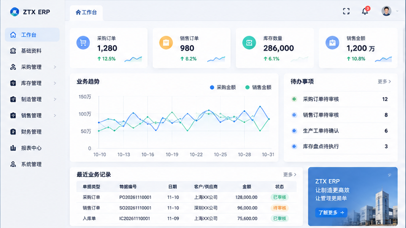
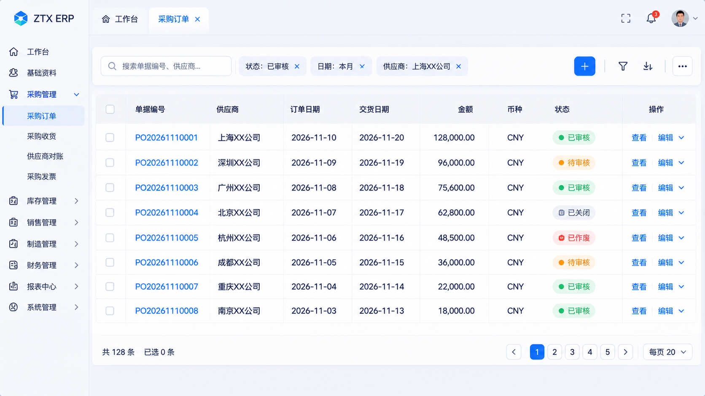
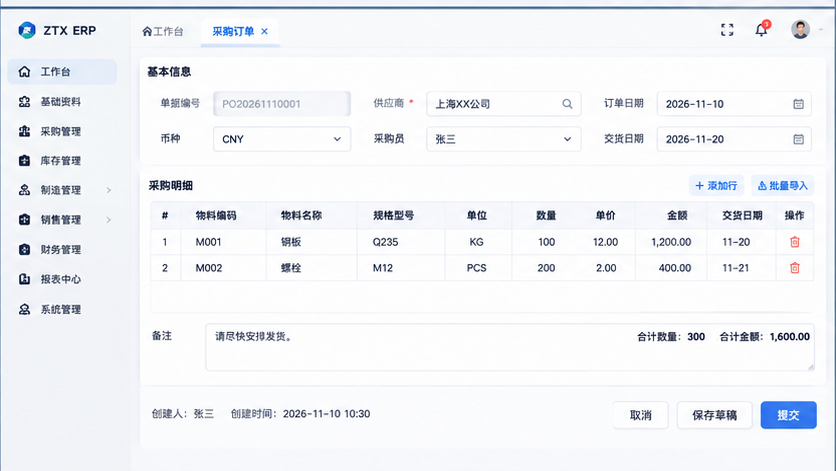
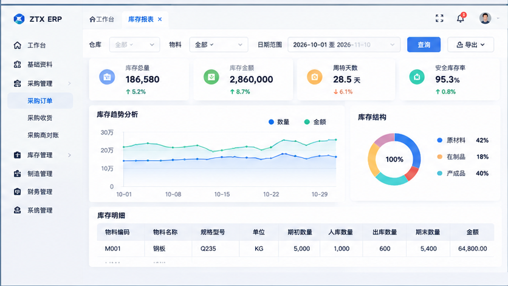

# ZTX 前端设计与技术规范（V1.1）

> 本文件合并原《ZTX Industrial Workspace 前端设计标准与交互蓝图》和《ZTX 前端技术架构与组件体系规范》，作为 ZTX V1.0 唯一的前端设计与技术规范。
>
> **版本说明：** 本次为 V1.0 文档结构收敛，不构成 V1.1 发布。总体架构与业务边界以《01_ZTX制造业低代码ERP平台总体设计方案_V1.0.md》为准；工程任务、阶段计划与 API 契约以《02_ZTX开发实施技术方案_V1.0.md》为准；本文件统一负责前端视觉、交互、组件、工具选型和实现路线。

## 1. 目标与总原则

ZTX 前端采用“自主掌握设计与组件、复用成熟底层交互能力、业务层不绑定第三方”的路线。

目标：

1. 建立长期可维护的 ZTX Design System 与 ZTX UI 组件库。
2. 支撑元数据驱动的表单、列表、查询视图和报表视图。
3. 支撑采购、库存、制造、销售、财务等高频 ERP 工作场景。
4. 保持桌面端高信息密度与操作效率，同时兼顾平板和移动端适配。
5. 限制第三方依赖的影响范围，允许未来替换底层实现。

### 1.1 必须遵守的原则

- **自研视觉规范**：颜色、字体、尺寸、密度、边框、状态色、布局和交互反馈由 ZTX 统一定义。
- **自研组件 API**：业务页面只使用 `Z*` 组件，不直接依赖 Reka UI、TanStack、ECharts 等第三方 API。
- **底层能力复用**：焦点管理、键盘导航、弹层定位、表格状态、虚拟滚动等成熟复杂能力优先使用经过评估的工具。
- **业务规则后置端**：前端负责交互和即时反馈，权限、库存、成本、审批和交易不变量由服务端最终裁决。
- **渐进建设**：先完成设计 Token、工作区、基础组件，再建设 ZListView、ZDocument 和 Metadata Renderer，不在 S0 一次性实现完整组件库。
- **可访问与可操作**：图标按钮必须有 Tooltip 和可访问名称；键盘、焦点、触屏和高对比度状态需纳入验收。
- **避免重复造轮子**：不自研浏览器基础设施、复杂定位算法、通用图表引擎和完整表格状态引擎。

## 2. Industrial Workspace 视觉与交互规范

### 2.1 设计定位
现代企业软件风格、制造业专业感、高信息密度、克制的视觉设计。吸收 2BizBox 的紧凑工作区与操作效率，吸收 ERPNext 的动态筛选和排序交互。

### 2.2 全局工作区
顶部多标签工作区；右侧仅全屏、通知、用户。左侧一级模块导航。列表、表单不重复显示独立大标题行。

### 2.3 三级导航
一级模块 → 二级业务分类 → 三级功能。二级分类悬停或点击打开右侧浮层，三级功能点击后打开工作区标签。采购管理分类示例：日常作业、单据查询、报表分析、采购设置。浮层支持延迟关闭、键盘、触屏、Esc、焦点管理；不设置第四级。菜单由 Menu Metadata 驱动，后端强制授权。

### 2.4 列表页
主数据、业务单据、业务查询共用 ZListView。第一行左侧搜索与筛选条件，右侧依次为筛选、排序、新建、批量操作、导出、更多；按钮优先图标化并提供 Tooltip/aria-label。第二行左侧“共 N 条、已选 N 条”，右侧简洁分页器。无独立操作行、无固定状态 Tab 行。筛选采用字段+操作符+值的动态条件，排序支持多字段。

```text
[搜索/筛选条件]                         [筛选] [排序] [+] [批量] [导出] [⋯]
□ 单据编号  供应商  订单日期  交货日期  金额  状态  操作
共 128 条  已选 0 条                                   ‹ 1 2 3 4 5 › 20条/页
```

### 2.5 表单页
不重复显示标题行；基本信息紧凑网格；明细表格为主体；金额汇总紧邻明细；附件、审批、版本历史、操作日志放内容区 Tab/折叠；操作栏固定底部并由权限、状态、工作流决定。

### 2.6 报表页
筛选区 → 指标摘要 → 图表分析 → 明细/分组汇总 → 钻取/导出。展示口径、单位/币种、期间、组织范围、更新时间。

## 3. 核心页面视觉草图

本节中的四张界面图是 ZTX V1.0 前端风格和布局的视觉基准。采购订单列表采用后续确认的新版单图，替换早期四宫格草图中的旧列表；其余三张沿用原草图对应区域。图片仅作为视觉与交互参考，具体字段、数据、权限和业务规则以元数据及业务设计为准。

### 1. 工作台首页

展示全局工作台、业务指标、业务趋势、待办事项及最近业务记录。



### 2. 采购订单列表（最终确认稿）

采用统一 ZListView：顶部一行承载搜索/筛选条件及右侧操作工具；第二行左侧显示记录数和选中数，右侧显示简洁分页器；表格紧随其后。新版草图保留了状态标签、币种列、查看/编辑入口及清晰的行列边界。



### 3. 采购订单表单

基本信息采用紧凑网格，采购明细表格作为主体，金额汇总靠近明细，底部提供取消、保存草稿和提交等操作。实际操作按钮须由权限、单据状态和工作流共同决定。



### 4. 库存报表

采用筛选区、指标摘要、趋势图、库存结构分析及库存明细组合布局；正式实现时必须同时展示统计口径、单位/币种、期间、组织范围和更新时间。



## 4. 前端分层架构

```text
ZTX Applications
  工作台 / 采购 / 库存 / 制造 / 销售 / 财务 / 报表
                 │
                 ▼
Metadata Renderer
  元数据表单 / 元数据列表 / 查询视图 / 报表视图
                 │
                 ▼
ZTX Business
  ZListView / ZDocument / ZDataGrid / ZSearchBar
  ZFilterBuilder / ZSubTable / ZWorkflow / ZReportView
                 │
                 ▼
ZTX UI
  ZButton / ZInput / ZSelect / ZDialog / ZPopover
  ZDropdown / ZTabs / ZTooltip / ZDatePicker / ZTree
                 │
                 ▼
Adapters & Utilities
  Reka UI / Floating UI / TanStack Table / Virtual
  VueUse / VeeValidate / Zod / Lucide / ECharts
```

依赖方向：

- `applications` 可以依赖 `metadata-renderer`、`business` 和 `ui` 的公开 API。
- `metadata-renderer` 可以组合 `business` 与 `ui`。
- `business` 可以依赖 `ui`，但不得依赖具体业务应用。
- `ui` 不得依赖 `business` 或具体业务模块。
- 第三方库只允许出现在 `ui` 的适配层、`business` 的引擎适配器或专门的基础设施模块中。
- 禁止业务页面直接导入第三方组件、第三方图标组件或第三方表格实例。

## 5. 技术选型与职责边界

选型是 V1.0 的推荐技术路线。具体版本不写死在设计文档中，Sprint 0 由技术负责人验证兼容性、维护活跃度、许可证、安全公告和 Vue 版本支持后锁定到依赖目录及锁文件。

| 分类 | 推荐技术 | 定位 | 采用原则 |
|---|---|---|---|
| UI 框架 | Vue 3 | 前端框架 | 必须 |
| 语言 | TypeScript | 类型系统 | 必须，严格模式 |
| 构建 | Vite | 开发与构建 | 必须 |
| 包管理 | pnpm Workspace | Monorepo 包管理 | 推荐作为工程标准 |
| 路由 | Vue Router | 路由与页面导航 | 必须 |
| 全局状态 | Pinia | 会话、工作区、用户偏好等状态 | 推荐；避免把服务端缓存全部塞入全局 Store |
| Headless 原语 | Reka UI | Dialog、Popover、Select、Tabs、Menu、Checkbox 等复杂交互原语 | 核心候选；按需引入，不把其 API 暴露给业务层 |
| 浮层定位 | Floating UI | Tooltip、Popover、菜单定位与边界避让 | 补充能力；先检查 Reka UI 是否已覆盖，避免重复引入 |
| 表格逻辑 | TanStack Table | 排序、筛选、列状态、行选择、分组等表格状态与模型 | 核心候选；ZTX 自己渲染表格 DOM 和样式 |
| 虚拟化 | TanStack Virtual | 大数据列表/表格虚拟滚动 | 性能需要时引入，不作为减少页面滚动的替代方案 |
| Vue 工具 | VueUse | 常用 Composition API 能力 | 推荐；审查具体 composable 的 SSR/生命周期行为 |
| 表单状态 | VeeValidate | 表单状态、校验触发和错误管理 | 推荐；由 ZForm 封装 |
| Schema 校验 | Zod | 前端结构化数据校验 | 推荐；服务端仍需独立校验 |
| 图标 | Lucide Vue | 统一线性图标 | 核心候选；统一图标风格和尺寸 |
| 图表 | Apache ECharts | 趋势、结构、分析图表 | 核心候选；通过 ZChart 适配层封装 |
| 组件文档 | Storybook | 组件目录、交互示例和状态展示 | 强烈推荐 |
| 单元测试 | Vitest | 工具函数、组件逻辑测试 | 必须 |
| 组件测试 | Vue Test Utils | Vue 组件行为测试 | 必须 |
| 浏览器 E2E | Playwright | 关键用户旅程、跨浏览器测试 | 必须 |
| 多语言 | Vue I18n | 多语言与格式化 | 按产品国际化需求引入 |
| 高精度前端计算 | decimal.js 或 big.js | 金额/数量展示辅助计算 | 仅在前端确有计算需要时引入；不可替代后端 BigDecimal |

### 5.1 关于 Headless UI 的边界

Headless UI 不等于完整视觉组件库。ZTX 使用它解决交互复杂度，而不是让它决定产品风格。

Reka UI 优先用于需要焦点管理、键盘操作、弹层行为和无障碍支持的组件。普通 Button、Input、Badge、Divider、Pagination 等简单组件由 ZTX 自行实现通常更直接。

Floating UI 与 Reka UI 存在能力交集。若 Reka UI 的对应组件已经满足定位、碰撞避让和滚动更新需求，不再为同一组件重复接入 Floating UI。只有独立浮层或特殊定位场景才直接使用 Floating UI。

### 5.2 关于表格引擎的边界

TanStack Table 是 headless 表格逻辑，不是开箱即用的 ERP 表格组件。ZTX 仍需实现：

- 表头、单元格、行、空状态、加载状态和错误状态。
- 列宽拖动、固定列、列顺序、列显隐和个人视图。
- 行选择、批量操作、键盘交互和响应式行为。
- 服务端分页、排序、筛选和汇总的 API 协议。
- 权限字段隐藏、脱敏和操作入口控制。

服务端分页模式下，筛选、排序和分页状态必须明确由服务端执行；不能将当前页数据误当作全量数据进行本地排序或统计。

### 5.3 关于表单校验的边界

VeeValidate 管理交互状态，Zod 描述前端数据结构和即时校验。跨单据、库存可用量、价格权限、审批状态、成本规则等业务规则必须由 Kotlin 服务端最终校验。客户端校验只改善体验，不构成安全边界。

## 6. ZTX 自研组件体系

### 6.1 Design System 与 Design Tokens

集中管理以下设计变量：

- 色彩：品牌主色、背景、文本、边框、状态色。
- 字体：中英文字体栈、字号、字重、行高。
- 间距：页面边距、区块间距、控件间距。
- 尺寸：顶栏、侧栏、表格行高、输入框和按钮高度。
- 圆角与阴影：克制使用，避免大面积卡片化和装饰性阴影。
- 动效：时长、缓动、减少动态效果偏好。
- 密度：compact / standard / comfortable。

建议 CSS Token 以语义命名，不让业务代码依赖具体色值：

```css
:root {
  --ztx-color-primary: #2864B4;
  --ztx-color-primary-hover: #1F559C;
  --ztx-color-page: #F1F3F6;
  --ztx-color-panel: #FFFFFF;
  --ztx-color-text: #263445;
  --ztx-color-text-secondary: #667487;
  --ztx-color-border: #DCE2E9;
  --ztx-color-success: #25845A;
  --ztx-color-warning: #C98922;
  --ztx-color-danger: #C74747;

  --ztx-height-topbar: 50px;
  --ztx-width-sidebar: 200px;
  --ztx-width-sidebar-collapsed: 56px;
  --ztx-height-table-header: 36px;
  --ztx-height-table-row-compact: 32px;
  --ztx-height-table-row-standard: 38px;
  --ztx-height-table-row-comfortable: 44px;
  --ztx-height-control: 32px;
  --ztx-space-section: 12px;
}
```

上述为初始设计值，需在真实业务数据、不同分辨率、浏览器缩放和字体设置下验证，不作为不可变硬编码。

### 6.2 ZTX UI 基础组件

| 组件 | 职责 | 建议实现 |
|---|---|---|
| ZButton | 按钮、尺寸、状态和加载反馈 | 自研 |
| ZInput / ZTextarea | 文本输入 | 自研 |
| ZCheckbox / ZRadio | 选择控件 | 可适配 Reka UI |
| ZSelect / ZCombobox | 选择与远程搜索 | 可适配 Reka UI |
| ZDatePicker | 日期选择 | 适配经验证的 Headless 原语 |
| ZDialog | 对话框与焦点管理 | 适配 Reka UI |
| ZPopover / ZDropdown | 浮层和菜单 | 适配 Reka UI，特殊定位可用 Floating UI |
| ZTabs | 标签切换 | 适配 Reka UI |
| ZTooltip | 提示 | 适配 Headless 原语 |
| ZTree | 树形选择/导航 | 评估原语能力后封装 |
| ZPagination | 分页器 | 自研 |
| ZBadge / ZTag | 状态和标签 | 自研 |
| ZIcon | 图标出口 | 封装 Lucide |
| ZEmpty / ZSkeleton | 空状态和加载占位 | 自研 |
| ZToast | 消息反馈 | 自研 API，底层可评估轻量方案 |

基础组件应提供统一的尺寸、禁用、只读、加载、错误、键盘和可访问属性；不追求一次性覆盖所有边缘功能。

### 6.3 ZTX Business 业务组件

优先建设下列可复用 ERP 业务组件：

| 组件 | 职责 |
|---|---|
| ZListView | 统一主数据、业务单据和业务查询列表容器 |
| ZDataGrid | 数据表格渲染与列交互 |
| ZSearchBar | 搜索框和常用筛选条件 |
| ZFilterBuilder | 高级筛选条件构建 |
| ZSortBuilder | 多字段排序配置 |
| ZColumnSetting | 列显隐、顺序、宽度和固定列设置 |
| ZForm / ZFormGrid | 表单状态与网格布局 |
| ZDocument | 单据工作区、状态和操作栏 |
| ZSubTable | 单据明细子表 |
| ZMoneyInput | 金额输入与精度展示 |
| ZQuantityInput | 数量、单位和精度展示 |
| ZItemSelector | 物料选择 |
| ZSupplierSelector | 供应商选择 |
| ZWarehouseSelector | 仓库选择 |
| ZStatusBadge | 业务状态呈现 |
| ZApprovalTimeline | 审批过程 |
| ZAttachmentList | 附件列表 |
| ZAuditLog | 操作审计展示 |
| ZReportView | 报表容器、指标、图表和明细钻取 |

组件要支持元数据配置和权限上下文，但不能把服务端业务规则搬进组件。

### 6.4 Metadata Renderer

Metadata Renderer 根据受控元数据组装 ZTX Business 和 ZTX UI，不直接生成任意 HTML 或执行任意脚本。

元数据可以描述：

- 字段、字段类型、标签、默认值、必填、只读、可见条件。
- 表单分区、列数、折叠、固定区域。
- 列表列、默认排序、可筛选字段、分页配置。
- 允许的组件类型和受控组件参数。
- 操作入口、状态展示和权限要求。

元数据不得包含任意 CSS、任意 JavaScript、任意 SQL 或绕过权限的表达式。复杂交易规则交由 Kotlin Business Service。

前端主要消费三类受控页面元数据：

- `Menu Metadata`：一级模块、二级业务分类、三级功能入口及其权限标识。
- `ListView Metadata`：列表字段、默认排序、可筛选字段、列宽/显隐默认值、分页与允许的批量操作。
- `Form Layout Metadata`：表单分区、字段顺序、列数、折叠、固定区、可见条件和只读条件。

## 7. 页面组件实现约束

### Workspace

- 多标签应支持关闭、固定/取消固定和工作区恢复；标签状态与菜单可见性随用户会话和权限上下文刷新。
- 前端菜单隐藏只改善体验，所有业务 API 仍必须在服务端独立鉴权。

### ZListView / ZDataGrid

- 服务端分页场景下，筛选、排序、分页和汇总必须按 API 契约由服务端执行，不得将当前页数据误作全量数据进行排序或统计。
- 列设置、个人视图和批量操作应有明确的用户范围、组织范围和权限边界。
- 列表字段可见性、脱敏和行级操作入口必须与服务端权限策略一致。

### ZDocument

- 底部固定/粘附操作栏必须为内容预留空间，不能遮挡最后一行明细或备注。
- 操作按钮由单据状态和服务端提供的能力信息共同决定；提交时服务端仍须重新校验。

### ZReportView

- 图表必须能追溯到明确的数据口径和查询条件；钻取结果应保留期间、组织范围及筛选上下文。

## 8. 高信息密度与可用性规则

高信息密度不等于把所有内容挤在一起。目标是减少无意义空白和多余滚动，同时保持层级、对齐和可读性。

| 元素 | 初始建议 |
|---|---:|
| 顶部导航 | 48–52px |
| 侧栏展开/收起 | 200px / 56px |
| 表格表头 | 36px |
| 表格行（紧凑/标准/宽松） | 32px / 38px / 44px |
| 表单控件 | 30–34px |
| 正文 | 约 13px，需兼顾缩放和可读性 |
| 区块间距 | 12px |

规则：

1. 先通过页面信息架构减少滚动，不以虚拟滚动掩盖布局问题。
2. 通过紧凑/标准/宽松密度档位适配不同用户和屏幕。
3. 重要数据使用对齐、列宽和分组表达，不依赖大卡片和强阴影。
4. 状态颜色语义统一：草稿灰、待审核橙、已审核绿、已关闭深灰、已作废红、执行中蓝。
5. 颜色不能作为唯一状态表达方式，必须同时显示文本或图标。
6. 桌面优先布局不得导致窄屏不可操作；移动端采用任务导向页面，而不是强行压缩桌面表格。
7. 键盘快捷键应有帮助说明，避免与浏览器、输入法和表单输入冲突。

## 9. 工程目录建议

建议在现有 `clients/web` 下采用 pnpm Workspace。S0 只建立最小工程骨架，不要求立即发布独立 npm 包。

```text
clients/web/
  package.json
  pnpm-workspace.yaml
  apps/
    erp-web/
  packages/
    design-tokens/
    ui/
    business/
    metadata-renderer/
    api-client/
    test-utils/
  docs/
    frontend-architecture.md
```

职责：

- `design-tokens`：CSS Variables、主题和密度变量。
- `ui`：基础 ZTX UI 组件和 Headless 适配器。
- `business`：ZListView、ZDocument、ZDataGrid 等 ERP 业务组件。
- `metadata-renderer`：将后端发布的元数据渲染为受控页面。
- `api-client`：统一 API 请求、认证上下文、错误处理和类型契约。
- `test-utils`：组件测试辅助、Mock 元数据和测试数据。
- `erp-web`：实际应用、路由、菜单和业务页面。

依赖方向必须通过 ESLint/依赖图或架构测试约束，避免循环依赖。

## 10. 测试与质量门禁

| 层次 | 工具 | 最低要求 |
|---|---|---|
| 工具函数/组合式逻辑 | Vitest | 格式化、筛选状态、列状态和权限显示逻辑 |
| 组件行为 | Vitest + Vue Test Utils | 键盘、焦点、禁用、错误、加载、空状态 |
| 视觉/交互目录 | Storybook | 核心组件具备默认、异常、禁用和紧凑密度示例 |
| 浏览器 E2E | Playwright | 登录、导航、列表筛选、单据编辑、提交、权限拒绝 |
| 无障碍 | Playwright 辅助检查及人工键盘检查 | 焦点可见、弹层焦点管理、图标名称、键盘闭环 |
| 视觉回归 | 截图对比 | 关键页面在固定视口下对比，容忍非关键动态区域 |

核心页面至少覆盖：工作台、采购订单列表、采购订单表单、库存报表。E2E 不应依赖脆弱的绝对坐标，优先使用角色、标签和稳定测试标识。

## 11. 实施顺序与范围控制

| 顺序 | 工作 | 交付与验收 |
|---|---|---|
| F0 | 前端工程底座、Token、Lint、测试框架 | 可启动、可构建、可测试；依赖锁定 |
| F1 | Workspace 与导航 | 顶栏、侧栏、三级菜单、多标签 |
| F2 | 基础 UI | Button、Input、Select、Dialog、Popover、Tabs、Tooltip 等 |
| F3 | ZListView / ZDataGrid | 搜索、筛选、排序、列设置、服务端分页 |
| F4 | ZDocument / ZSubTable | 表单网格、明细、汇总、底部操作栏 |
| F5 | Metadata Renderer | 由元数据生成受控列表与表单 |
| F6 | ZReportView | 指标、图表、明细、钻取、导出 |
| F7 | 稳定性完善 | E2E、无障碍、性能和视觉回归 |

阶段约束：

- S0：只搭工程骨架、Token 起点、基础路由和健康页面，不提前实现全套 UI。
- S1：实现登录态、用户上下文、权限菜单和工作区基础。
- S2：实现元数据读取、受控渲染基础、列表查询协议和字段权限联动。
- S3：完善通用表单、Document Runtime 对接和主数据页面。
- S4 起：结合采购、收货、库存等真实业务迭代 ZListView、ZDocument 和专用选择器。
- ECharts、虚拟滚动、复杂列设置等按真实需求引入，避免早期过度建设。

## 12. 需要在 Sprint 0 冻结的技术决策

以下内容不在文档中伪造固定版本号，必须在工程启动时通过小型验证项目确认：

1. Vue 3、Vite、TypeScript、pnpm 的兼容矩阵。
2. Reka UI 对所需组件的覆盖情况及其与 Floating UI 的依赖关系。
3. TanStack Table 当前稳定主版本与 Vue 适配方式；验证服务端分页/筛选/排序。
4. TanStack Virtual 是否与目标表格 DOM 结构兼容。
5. VeeValidate 与 Zod 的集成方式，以及动态元数据 Schema 的构造策略。
6. ECharts 的按需注册、主题、打包体积和销毁生命周期。
7. Storybook 与 Vue/Vite 版本兼容性。
8. Playwright 浏览器矩阵、CI 运行方式和测试数据隔离。
9. 所有第三方依赖的许可证、安全公告、维护状态和传递依赖。

冻结结果应记录在 `pnpm-lock.yaml`、`package.json`、版本矩阵文档和 ADR 中；禁止使用 `latest` 或不受控动态版本。

## 13. 验收清单

- [ ] 业务页面不直接导入第三方 UI/表格/图表组件。
- [ ] ZTX UI 对外 API 与底层 Headless 实现隔离。
- [ ] 颜色、字号、尺寸、密度来自统一 Design Tokens。
- [ ] 主数据、业务单据、业务查询共用 ZListView。
- [ ] ZDocument 无重复标题行，底部操作栏不遮挡内容。
- [ ] 列表服务端分页、筛选和排序语义明确。
- [ ] 图标按钮具有 Tooltip、可访问名称和键盘焦点状态。
- [ ] 动态元数据不能注入任意 CSS、脚本或 SQL。
- [ ] 前端校验不替代服务端权限和业务校验。
- [ ] 核心页面具备 Storybook 示例、组件测试和 Playwright E2E。
- [ ] 依赖版本、许可证和安全状态已评审并锁定。


## 14. 工程版本基线（V1.1）

前端 S0 采用以下正式稳定版本，并在 clients/web/package.json 与 pnpm-lock.yaml 中精确锁定：

| 分类 | 版本 |
|---|---:|
| Node.js | 26.13.1 LTS |
| pnpm | 12.18.0 |
| Vue | 3.5.45 |
| Vue Router | 5.5.0 |
| Pinia | 4.1.0 |
| Vite | 8.3.8 |
| @vitejs/plugin-vue | 6.0.10 |
| TypeScript | 6.0.3 |
| vue-tsc | 3.3.14 |
| Vitest | 5.1.0 |
| Vue Test Utils | 2.5.1 |
| jsdom | 31.0.0 |
| ESLint | 10.14.0 |
| eslint-plugin-vue | 10.12.1 |
| typescript-eslint | 8.72.2 |

TypeScript 暂定 6.0.3，是因为当前 typescript-eslint 稳定版本声明的 TypeScript peer 范围尚未覆盖 TypeScript 7；待相关工具链正式兼容后再升级。Vite 8 使用 Node 26 LTS；不使用 nightly、beta、RC 或动态 latest 标签。

S0 只搭建 Workspace、Token、基础工作区路由、API Client 和质量工具链，不提前建设完整 ERP 组件库。第三方库不得从业务页面直接导入；后续统一通过 ZTX 自有组件 API 和适配层使用。


## 15. S1 身份与会话界面

S1 提供租户代码、用户名和密码登录；Access Token 仅保存在 Pinia 内存状态，不写入 localStorage/sessionStorage。Refresh Token 由服务端设置 HttpOnly、SameSite Cookie；应用启动时调用刷新接口恢复会话。退出登录调用服务端撤销会话，再清除客户端 Access Token。用户身份和租户上下文以服务端验证结果为准，不接受浏览器自行指定 tenantId。


## 16. S2 元数据驱动列表与设计器

列表页面通过 DocType 元数据生成列定义，再调用统一 Query API 获取数据；搜索条件生成 Filter AST，分页参数通过 QueryRequest 传递。元数据设计器可创建租户级草稿并发布版本。页面不直接拼接 SQL，也不将数据库物理列名暴露为可执行指令。


## 16. S3 主数据列表与 Document Runtime 页面约定

S3 的主数据页面先复用现有 ZTX 工作区、Token 和元数据 API，不引入成品 UI 框架：

- 主数据列表由 DocType 字段元数据生成，服务端执行查询、筛选、排序和分页；仅展示当前用户具有读取权限的字段。
- 新建/编辑页面根据字段类型、必填标记和状态元数据生成表单；保存通过 `If-Match` 传递版本，冲突必须提示刷新，不允许静默覆盖。
- 单据详情显示编号、单据状态、版本号；草稿显示保存、提交、取消操作，操作入口同时受 API 权限和状态约束。
- 版本历史展示版本号、变更来源、原因、时间和字段差异；快照中的无权字段必须脱敏。
- 主数据导入使用 JSON 模板，逐行显示成功、重复跳过和失败行号/原因；重复业务编码不得产生重复记录。
- 状态采用文字标签，不以颜色作为唯一表达；停用记录保留查询能力，但不能作为新记录的有效引用。

